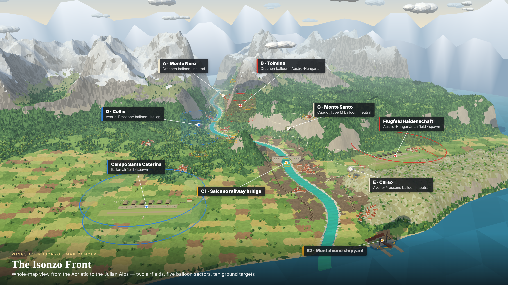

# Wings over Isonzo

WW1 arcade flight game over the Isonzo front, 1917. Flat-shaded low-poly, no textures, runs in the browser with no build step.

This is the minimal playable build: a team dogfight on the Isonzo Front map with one fighter per side, bots, and multiplayer for up to 6 v 6.



## Play

```bash
npm install
```

```bash
npm start
```

Open http://localhost:8080. Any static file server works; the game is plain ES modules.

- **Solo:** leave the squadron password empty. Bots fill both sides.
- **Multiplayer:** everyone enters the same squadron password. Up to 6 pilots per side; bots fill the remaining seats up to "Pilots per side".
- **Start:** on the runway (the default), or in the air over your airfield. On the runway, open the throttle, let the tail come up, and ease the stick back at flying speed. Bots take off too when the host starts on the runway.
- **Balloons:** the observation balloons, their baskets and cables are solid; flying into one destroys the aircraft.
- **Bots:** Rookie (the default), Regular or Ace, or no bots at all, chosen in the lobby. In multiplayer the host's choice applies.
- **Collisions:** two aircraft that touch are both destroyed, so don't ram.
- **Sides:** Italy flies the SPAD VII (faster), Austria-Hungary the Albatros D.III (turns tighter).
- **Round:** every aircraft lost gives the other side a point. First to 30 wins and the round restarts.

| Control | Keys |
|---|---|
| Pitch | `W` / `S` or `↑` / `↓` (`S` pulls the nose up) |
| Roll | `A` / `D` or `←` / `→` |
| Rudder | `Q` / `E` |
| Throttle | `Shift` up, `Ctrl` or `C` down |
| Fire | `Space` or mouse button |
| Sound on / off | `M` |
| Time of day, back / forward one hour | `[` / `]` |
| Camera smoothing, less / more | `,` / `.` |

### Damage

Based on Home Skies 1917, with hits located on the airframe: where a round strikes decides what it damages. Shots from astern tend to find the tail, head-on shots the engine, and shots from the side the wings.

| Zone | Effect |
|---|---|
| Engine | Less power and an oil leak (oil trail, spatter on your view); badly hit it misfires; destroyed means no power; it may catch fire |
| Left / right wing | Sluggish roll, higher stall speed, and the aircraft keeps rolling toward the damaged side; a destroyed wing breaks away, a badly damaged one folds in a fast dive |
| Tail controls | Weak elevator and rudder; destroyed means the tail is shot away |
| Fuel tank | Leaks; with no fuel the engine stops |

Each change in handling is announced in the feed. A burning aircraft loses airframe strength until the fire is blown out in a dive faster than top speed. An aircraft that loses a wing, its tail or all its strength goes down: it noses over, spins and falls fast. The loss is scored at that moment. The panel at the bottom left shows every zone. When it is your own aircraft going down, the view cuts to a cinematic shot: a fixed camera ahead of the fall, a tighter lens and letterbox bars, held on the wreck until you are back in the air.

### Day and night

The sun rises in the east at 06:00 and sets in the west at 18:00; the moon is up through the night. Both light the scene and cast shadows. Pick the starting hour and how fast the clock runs in the lobby, and nudge the time in flight with `[` and `]`. In multiplayer the host's clock applies to everyone.

### Game modes

Pick the mode on the Game tab. In multiplayer the host's mode applies to everyone.

**Zeppelin Front** (the default). Each side starts with 150 tickets and loses when it reaches 0.

- **Airships:** each side has one, patrolling a racetrack about a third of the way from its airfield toward the front. Each has 6 gas cells. Shoot a cell until it bursts into flame; fire then spreads slowly to its neighbours. With 3 cells alight the airship goes down: it noses over, falls burning and explodes on the ground. Losing it costs **50 tickets**. Its gunners defend it from the upper and lower gun positions, and flying into it is fatal.
- **Gradisca:** the ground point in the middle, between the two airfields. Fly low over it (inside the ring, below the top of the faint wall) to capture it; more of your aircraft than the enemy's makes it go faster, and equal numbers hold it contested. The side holding it drains **1 enemy ticket every 4 seconds**.
- **Aircraft:** every aircraft lost costs its side **1 ticket**.
- **Bots:** they take roles in turn: capture Gradisca, attack the enemy airship, hunt fighters, escort their own airship.
- **HUD:** the bar under the score shows each airship's gas cells and who holds Gradisca. Markers and edge arrows point to both airships and Gradisca, and the minimap shows them too.

**Dogfight.** No objectives; the first side to 30 kills wins the round.

### Controllers

Gamepads, joysticks, throttles and rudder pedals work alongside the keyboard. The start screen is the first tab of **Options** (Game, Controls, Flight, Graphics, Audio); press `Esc` in flight to reopen the others; controller settings are on the Controls tab.

- **Assign:** press Assign next to an action, then move that control (or press that button). Each binding remembers its device, so a stick, a throttle and pedals can be mixed.
- **Standard layout:** an Xbox / PlayStation style pad is set up automatically — left stick pitch and roll, right stick rudder and throttle, right trigger fires.
- **Lever:** tick "lever" on the throttle axis when it is a real throttle lever, so its position sets the throttle directly.
- **Calibrate:** two steps — release everything to record the centres, then move every control to its end stops.
- **Dead zone / response curve:** ignore small movements near centre, and soften the response around it.

Settings are saved in the browser.

### Finding other aircraft

Aircraft in view carry a marker with name and distance: a diamond for enemies, a ring for friends. Aircraft out of view are shown by arrows on a ring round the centre of the screen, pointing the way to turn; enemy arrows are red, larger when closer, and show the distance.

### Handling

The flight model and chase camera come from Home Skies 1917:

- The aircraft turns by banking and holds the bank you set; there is no self-levelling.
- The flight path follows the nose only as fast as the wings can pull, so hauling back hard bleeds speed.
- Below stall speed the aircraft sinks and drops its nose; let it dive to recover.
- The camera sits behind and above and always keeps the horizon level. How lazily it follows is the "Camera smoothing" slider on the Controls tab of Options.

### Flight options

Options has a Flight tab that changes how your own aircraft handles: pitch, roll and rudder response, optional wing levelling, stall speed, top speed, how much speed hard turns cost, aircraft toughness, and inverted pitch. Presets give Forgiving, Standard and Demanding settings in one click. Bots always fly the standard model, so in a shared battle each pilot can choose their own.

### Audio options

Options has an Audio tab with a volume slider for each kind of sound: master, your engine, other aircraft (their engines and the Doppler pitch drop as they pass), wind, guns, hits and explosions. Each runs from silent to double the designed level, has a Test button, and is saved in the browser. A Mute checkbox does the same as `M`.

### Graphics options

Options has a Graphics tab: shadows on or off, shadow distance (how far from your aircraft shadows reach when you are high, up to 2000 m; further means softer shadows), and rendering scale (the resolution the 3D view is drawn at; lower is faster). Settings are saved in the browser. Adding `?shadows=0` to the URL also turns shadows off.

## Multiplayer

There is no game server. The password picks the room and encrypts the traffic.

- **Default — peer-to-peer.** [Trystero](https://github.com/dmotz/trystero) finds the other players through public Nostr relays, then game data flows directly between browsers over WebRTC. Some networks block this; if players cannot see each other, use the relay below. A TURN server can be supplied by setting `window.WOI_TURN` before the game loads.
- **Fallback — WebSocket relay.** Run `npm run relay` (port 8787, or `PORT`) on any host and have every player enter its address under "Connection options", or open the game with `?relay=wss://your-host`. The relay only forwards AES-GCM ciphertext and never sees the password.

How the game stays in sync:

- Each browser simulates its own aircraft and sends its state 15 times a second.
- The shooter decides hits; the owner of the target applies the damage and announces the kill.
- Bots and the score are run by one player (the lowest peer id). If that player leaves, the next one takes over.

Nothing here is cheat-proof; it is built for friends sharing a password.

URL parameters: `name`, `pw`, `team` (`it` / `ah`), `size` (1–6), `time` (start hour), `clock` (speed), `bots` (-1 none, 0 rookie, 1 regular, 2 ace), `start` (`air` / `runway`), `mode` (`front` / `dogfight`), `relay`, `autostart=1`, `shadows=0`.

## Layout

| Path | What |
|---|---|
| `index.html` | Lobby and HUD markup |
| `src/world.js` | Map definition: terrain height function, coastlines, airfields, balloon sectors, ground targets |
| `src/terrain.js` | Terrain, trees, sky, and the water shader for the river and sea |
| `src/objects.js` | Aircraft, balloons, airfields, towns, ground-target models |
| `src/front.js` | Zeppelin Front mode: airships, the Gradisca capture point, tickets, bot objectives |
| `src/plane.js` | Aircraft types, flight model, bot pilot |
| `src/gamepad.js` | Controller bindings, calibration and the setup panel |
| `src/daynight.js` | Sun, moon, stars, sky colours and the clock |
| `src/sound.js` | Engine loop playback, and synthesised wind, gun and explosion sounds |
| `assets/engine.mp3` | Propeller engine recording used for the engine note |
| `src/net.js` | Password rooms over Trystero or the WebSocket relay |
| `src/main.js` | Game loop, guns, scoring, networking, HUD |
| `server/relay.js` | Optional WebSocket relay |
| `docs/concept/` | Map concept images |

To add an aircraft, add an entry to `TYPES` in `src/plane.js` with a model builder from `src/objects.js`.

## Not in yet

Balloon sectors and ground targets are on the map as scenery only; capture zones, bombing, landing, and touch controls are still to come.

Third-party code in `vendor/` (three.js, Trystero) is MIT licensed; see the licence files there.
